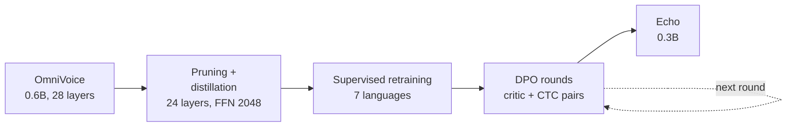

# Echo

**Echo is a voice-cloning-first text-to-speech model, built to run efficiently on-device.** Give it a few seconds of
anyone's speech and it speaks new text in that voice: timbre, accent, speaking style and emotion, which it imitates
especially well, with no fine-tuning. It speaks seven languages (English, German, French, Spanish, Italian, Polish and
Portuguese). With only 0.3B parameters and a highly optimized diffusion process, it runs many times faster than real
time on a phone or laptop, offline, with no per-request cost and no audio leaving the device.

## What is Echo?

Echo starts from [OmniVoice](https://github.com/k2-fsa/OmniVoice), a 0.6B masked-diffusion TTS model: it fills in a
grid of audio-codec tokens (8 codebooks per frame) over several denoising passes, conditioned on the text and on the
reference speaker's audio. Echo was made from it in three stages:

1. **Pruning with distillation.** 4 of the 28 transformer layers are dropped, the FFN shrinks from 3072 to 2048, and the
   text vocabulary from 151,676 to 62,035 tokens. The pruned student is trained to match OmniVoice's predictions.
2. **Supervised retraining** on our dataset in the seven languages: cleaned, deliberately selected subsets of popular
   open datasets such as [Emilia](https://huggingface.co/datasets/amphion/Emilia-Dataset) and variants of YODAS2,
   such as [yodas2-sidon](https://huggingface.co/datasets/sarulab-speech/yodas2_sidon).
3. **RLHF-like post-training with DPO.** The model generates several takes per prompt, a critic fitted on human
   preference rankings and a CTC intelligibility check pick winners and losers, and DPO trains on those pairs, in
   rounds.



Along the way, three changes make each generation cheaper:

- **CFG self-distillation.** Classifier-free guidance normally runs every pass twice, with and without conditioning.
  Echo learned the guided output directly, so each pass is one forward.
- **Prefix blocking.** The text and reference prefix never attends to the generated audio, so its keys and values are
  computed once and reused by every pass instead of recomputed.
- **A two-stage sampler.** 8 passes decide codebooks 0–1, then one polish pass decides codebooks 2–7: 10 forwards in
  all, against OmniVoice's default of 32 guided passes (64 forwards).

### Size and speed

| | OmniVoice | Echo |
|---|---|---|
| Parameters | 613M | **297M** |
| Weights | 2.45 GB (fp32) | 612 MB (fp16), 352 MB (int8), 232 MB (int4) |
| Forwards per generation | 64 (32 passes with CFG) | **10** |

Generation time from text to audio codes on an Apple M4 Pro (ExecuTorch MLX, median; speed relative to real time in
brackets). OmniVoice here runs 16 guided passes, half its default:

| Reference + target speech | OmniVoice | Echo int8 | Speed-up |
|---|---|---|---|
| 5 s + 5 s | 2,278 ms (2.2×) | **175 ms (28.5×)** | 13.0× |
| 5 s + 10 s | 3,388 ms (3.0×) | **300 ms (33.4×)** | 11.3× |
| 10 s + 5 s | 3,132 ms (1.6×) | **192 ms (26.1×)** | 16.3× |
| 10 s + 10 s | 4,157 ms (2.4×) | **317 ms (31.5×)** | 13.1× |

## Samples

Each row pairs a reference recording with Echo speaking a new text in the same voice. References are passed through the
same audio codec as Echo's output, for a fair comparison. These samples come from a prototype Echo model, before
post-training.

| Voice | Language | Reference | Echo |
|---|---|---|---|
| Melissa | English | [reference](assets/samples/melissa_reference.mp4) | [Echo](assets/samples/melissa_echo.mp4) |
| Shepherd | English | [reference](assets/samples/shepherd_reference.mp4) | [Echo](assets/samples/shepherd_echo.mp4) |
| Jordan | English | [reference](assets/samples/jordan_reference.mp4) | [Echo](assets/samples/jordan_echo.mp4) |
| Missler | German | [reference](assets/samples/missler_reference.mp4) | [Echo](assets/samples/missler_echo.mp4) |
| Jean-Pierre | French | [reference](assets/samples/jean_pierre_reference.mp4) | [Echo](assets/samples/jean_pierre_echo.mp4) |
| Corrado | Italian | [reference](assets/samples/corrado_reference.mp4) | [Echo](assets/samples/corrado_echo.mp4) |
| Bruno | Portuguese | [reference](assets/samples/bruno_reference.mp4) | [Echo](assets/samples/bruno_echo.mp4) |

## Layout

| | |
|---|---|
| `echo/model/` | the config and the model, wrapping `OmniVoice` |
| `echo/data/` | manifests, length-aware batching, preprocessing |
| `echo/training/` | the loop, the losses, checkpoints, several GPUs |
| `echo/rl/` | the DPO post-training: prompts, critic, pairs, evaluation |
| `echo/eval/` | a single denoising step, and the whole diffusion process |
| `echo/configs/` | model and training stage configs |
| `omnivoice/` | the upstream OmniVoice code |
| `scripts/` | training, RL rounds, evaluation, export and data |
| `assets/samples/` | the audio samples above |
| `knowledge/` | how to run it, and what was measured |

## Getting started

```bash
uv sync                                    # or: pip install -e .
./scripts/download_data.sh                 # train, dev and test into ./data
.venv/bin/python scripts/train/smoke_stage_1.py --steps 5
.venv/bin/python scripts/train/stage_1_prefix_blocking.py
```

[knowledge/running_the_scripts.md](knowledge/running_the_scripts.md) has the rest - several GPUs,
resuming, and evaluating a checkpoint. [knowledge/downloading_the_data.md](knowledge/downloading_the_data.md)
covers the one-time rclone setup.

## Tests

```bash
.venv/bin/pytest tests/ -q
.venv/bin/ruff check echo scripts tests
```

## License and acknowledgments

- **Code:** Apache 2.0, the same as OmniVoice's; see [LICENSE](LICENSE).
- **Model weights:** [CC BY-NC 4.0](https://creativecommons.org/licenses/by-nc/4.0/), for non-commercial use with
  attribution.

Echo's weights were initialized from [OmniVoice](https://github.com/k2-fsa/OmniVoice) by the k2-fsa team, and
`omnivoice/` contains their code. We thank its authors for releasing the model and code openly. Echo also uses the
[Higgs Audio v2 tokenizer](https://huggingface.co/eustlb/higgs-audio-v2-tokenizer) as its audio codec.
