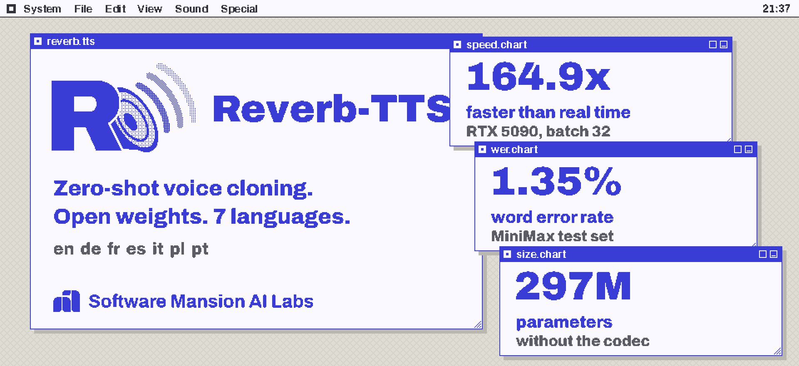

# Reverb-TTS

<p align="center">
  <a href="https://huggingface.co/software-mansion/Reverb-TTS"></a>
  <a href="LICENSE"></a>
  <a href="https://creativecommons.org/licenses/by-nc/4.0/"></a>
  <a href="https://discord.swmansion.com"></a>
</p>

**Reverb** is a voice-cloning text-to-speech model: give it a few seconds of someone speaking and the transcript, and
it speaks any text in that voice. This repository holds the Python package that runs it.

- **Zero-shot cloning** from 3 to 10 seconds of speech and its transcript, with no fine-tuning.
- **7 languages:** English, German, French, Spanish, Italian, Polish, and Portuguese. A voice can speak any of them.
- **1.35% word error rate** on the MiniMax test set, the lowest of the six open-weight models we compared.
- **297M parameters**, against OmniVoice's 613M.
- **164.9× real time** on an RTX 5090 at batch 32, **21.6×** on an Apple M4 Pro at batch 1.
- **Weights:** fp32, int8, int8a8, and int4 safetensors, and ExecuTorch programs for MLX, Vulkan, and QNN.

## Install

```bash
pip install git+https://github.com/software-mansion-labs/Reverb-TTS
```

Python 3.10 or later. The weights download from [Hugging Face](https://huggingface.co/software-mansion/Reverb-TTS) on
first use. They're gated: request access on the model page, then log in with `hf auth login` or set `HF_TOKEN`.

## Quick start

```python
import soundfile as sf
from reverb_tts import TTS

tts = TTS.from_pretrained()
voice = tts.voice("reference.wav", "The exact transcript of the reference recording.", language="en")
audio = tts.generate("Hello! This is my cloned voice.", voice, language="en")
sf.write("output.wav", audio, tts.sample_rate)
```

No recording at hand? Use a preset voice:

```python
voice = tts.preset_voice("standard_male")  # tts.preset_voices() lists them all
audio = tts.generate("Dzień dobry! Mówię po polsku.", voice, language="pl")
```

`TTS.from_pretrained` picks CUDA, Apple's MPS, or the CPU, in that order. Numbers, dates, money, and abbreviations are
read out as words, and long texts are split at sentence ends, so you can pass text as you'd write it.

## Documentation

- [Overview](docs/overview.md): what the model is, how it was made, and how it scores.
- [Usage](docs/usage.md): every use case, from the quick start to sampler settings.
- [Reference](docs/reference.md): model variants, on-device programs, and the repositories' layout.

## Benchmarks

On the [MiniMax Multilingual Test Set](https://huggingface.co/datasets/k2-fsa/TTS_eval_datasets), across Reverb's
seven languages:

| Model | Parameters (model + codec decoder) | WER ↓ | SIM-o ↑ | RTX 5090, × real time ↑ |
|:---|---:|---:|---:|---:|
| **Reverb** | **319M** | **1.35%** | 0.818 | **164.9×** |
| [OmniVoice](https://huggingface.co/k2-fsa/OmniVoice) | 634M | 1.64% | **0.835** | 13.2× |
| [VoxCPM2](https://huggingface.co/openbmb/VoxCPM2) | 2,336M | 1.55% | 0.810 | 3.0×¹ |
| [Qwen3-TTS 1.7B Base](https://huggingface.co/Qwen/Qwen3-TTS-12Hz-1.7B-Base) | 2,031M | 1.52%² | 0.781 | 4.0× |

¹ No batched generation: sentences run one at a time. ² Polish excluded: Qwen3-TTS doesn't support it.<br>
The full tables and the method are in the [overview](docs/overview.md#results).

## Develop

```bash
uv venv && uv pip install -e ".[test]" && .venv/bin/pytest
```

The tests run on a small random model, so they need no download.

## Use it responsibly

Clone only voices you have the right to use. Get the speaker's consent, don't impersonate real people, and don't use
generated speech to deceive, defraud, or harass. Tell your listeners when they hear a synthetic voice.

## License and acknowledgments

- **Code:** Apache 2.0; see [LICENSE](LICENSE).
- **Model weights:** [CC BY-NC 4.0](https://creativecommons.org/licenses/by-nc/4.0/), for non-commercial use with
  attribution.

Reverb's weights were initialized from [OmniVoice](https://github.com/k2-fsa/OmniVoice) by the k2-fsa team, and its
target-length rule and prompt format come from OmniVoice's code. We thank its authors for releasing the model and code
openly. Reverb uses the [Higgs Audio v2 tokenizer](https://huggingface.co/eustlb/higgs-audio-v2-tokenizer) as its audio
codec, and [Verbalis](https://github.com/software-mansion-labs/Verbalis) prepares its text.

## Community Discord

[Join the Software Mansion Community Discord](https://discord.swmansion.com) to chat about Reverb or other Software
Mansion libraries.

## Reverb is created by Software Mansion

Since 2012, [Software Mansion](https://swmansion.com) has been a software agency with experience in building web and
mobile apps. We are Core React Native Contributors and experts in dealing with all kinds of React Native issues. We can
help you build your next dream product – [Hire us](https://swmansion.com/contact/projects?utm_source=reverb\&utm_medium=readme).

[](https://swmansion.com)
