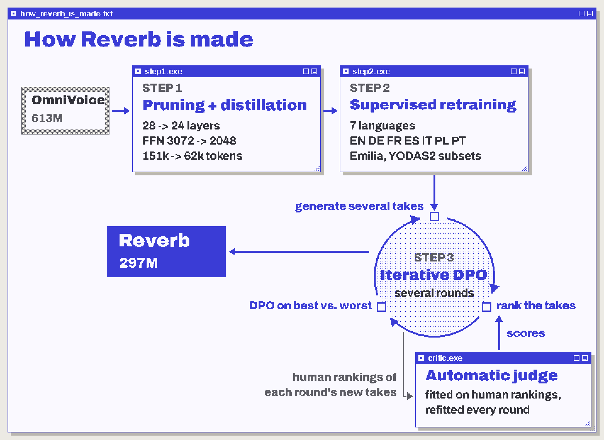
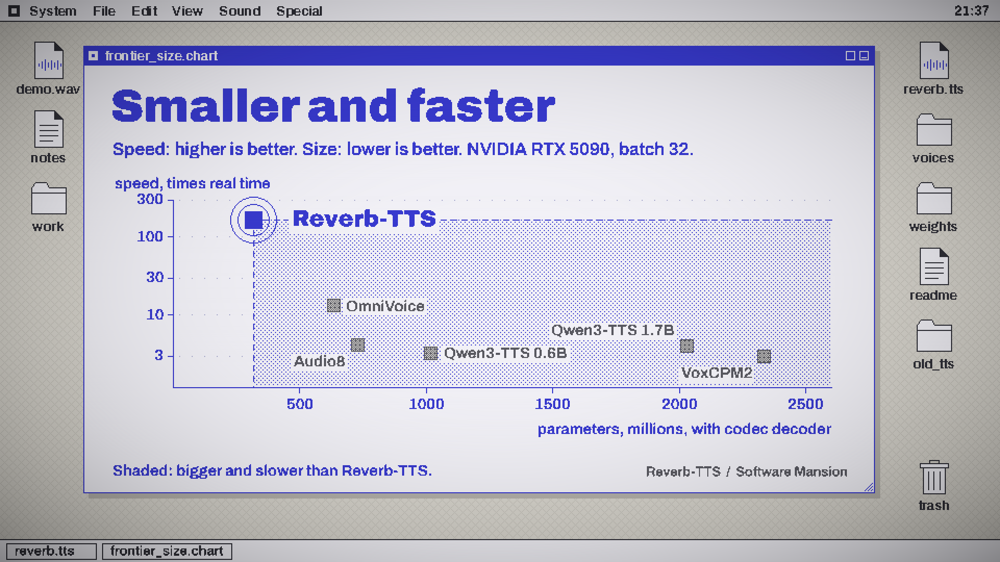

# Overview

Reverb is a masked-diffusion text-to-speech model. It fills in a grid of
[Higgs audio codec](https://huggingface.co/eustlb/higgs-audio-v2-tokenizer) tokens (8 codebooks per frame, 25 frames per
second) over a few passes, conditioned on the text and on a reference recording of the voice to clone.

## How it was made

1. **Initialized from [OmniVoice](https://github.com/k2-fsa/OmniVoice)**, a 612M-parameter masked-diffusion TTS model.
2. **Pruned with distillation:** 4 of the 28 transformer layers removed, the FFN cut from 3072 to 2048, the KV groups
   from 8 to 6, the text vocabulary from 151,676 to 62,035 tokens; the pruned model was trained to match OmniVoice's
   predictions.
3. **Retrained** on cleaned, selected subsets of open speech datasets in the seven languages.
4. **Preference post-training (RLHF-like):** the model generated several takes per prompt, a critic fitted on human
   preference rankings and a CTC intelligibility check picked the better and worse ones, and DPO trained on those pairs.

<picture>
  <source media="(prefers-color-scheme: dark)" srcset="assets/training_scheme_dark.png">
  
</picture>

## Results

We compare Reverb with open-weight voice-cloning models on the
[MiniMax Multilingual Test Set](https://huggingface.co/datasets/k2-fsa/TTS_eval_datasets), restricted to Reverb's seven
languages: 700 sentences, 100 per language, each spoken in the voice of one of two reference speakers of that
language. Every model generates one take per sentence with its default settings. WER (Whisper large-v3) and speaker
similarity (SIM-o) come from OmniVoice's evaluation scripts and are averaged over the languages.

| Model | Parameters: model + codec decoder | WER ↓ | SIM-o ↑ |
|:---|---:|---:|---:|
| **Reverb** | **297M + 22M** | **1.35%** | 0.818 |
| [OmniVoice](https://huggingface.co/k2-fsa/OmniVoice) | 612M + 22M | 1.64% | **0.835** |
| [Audio8-TTS-Realistic-Air](https://huggingface.co/Edge0/Audio8-TTS-Realistic-Air) | 601M + 131M | 1.97% | 0.750 |
| [Qwen3-TTS 0.6B Base](https://huggingface.co/Qwen/Qwen3-TTS-12Hz-0.6B-Base) | 915M + 105M | 11.96%¹ | 0.781 |
| [Qwen3-TTS 1.7B Base](https://huggingface.co/Qwen/Qwen3-TTS-12Hz-1.7B-Base) | 1,929M + 102M | 1.52%¹ | 0.781 |
| [VoxCPM2](https://huggingface.co/openbmb/VoxCPM2) | 2,290M + 46M | 1.55% | 0.810 |

The model's count is the one Hugging Face reports for its weights; the codec decoder turns codes into audio. Encoders
used only to process the reference recording are not counted. 
¹ Qwen3-TTS does not support Polish, so its WER is averaged over the other six languages. For Qwen3-TTS 0.6B, 4 of 600 takes
didn't stop and were cut at 480 tokens (about 38 s); without them its WER is 1.78%.

Generation speed, in × real time (seconds of audio per second of compute; higher is better), on MiniMax English
sentences. Timing starts from the text and an already-encoded reference voice. Every model runs its default settings.

| Hardware | Reverb | OmniVoice | Audio8 | Qwen3-TTS 0.6B | Qwen3-TTS 1.7B | VoxCPM2 | Fish S2 Pro |
|:---|---:|---:|---:|---:|---:|---:|---:|
| NVIDIA RTX 5090, batch 32 | **164.9×** | 13.2× | 4.2× | 3.3× | 4.0× | 3.0ײ | 0.18ײ |
| Apple M4 Pro, batch 1 | **12.3׳** | 0.84× | 0.76× | 0.51× | 0.52× | 0.69× | – |
| iPhone 17, batch 1 | **20.6×** | 0.91× | 1.03× | 1.14× | 0.74× | – | – |

RTX 5090 and M4 Pro: PyTorch in bf16 on the GPU, to the waveform with codec decoding. iPhone 17: ExecuTorch MLX
programs in fp16 on the GPU, to the codec codes, without the decoder. 
² No batched generation: sentences run one at a time. 
³ Reverb's ExecuTorch MLX program (fp16) with the Core ML codec decoder, as it ships: 21.6×.

<picture>
  <source media="(prefers-color-scheme: dark)" srcset="assets/frontier_size_speed_dark.png">
  
</picture>

### Time to codes on an Apple M4 Pro

ExecuTorch MLX, median time from the text to audio codes, without codec decoding (speed relative to real time in
brackets), against OmniVoice at 16 guided passes:

| Reference + target speech | OmniVoice | Reverb int8 | Speed-up |
|---|---|---|---|
| 5 s + 5 s | 2,278 ms (2.2×) | **175 ms (28.5×)** | 13.0× |
| 5 s + 10 s | 3,388 ms (3.0×) | **300 ms (33.4×)** | 11.3× |
| 10 s + 5 s | 3,132 ms (1.6×) | **192 ms (26.1×)** | 16.3× |
| 10 s + 10 s | 4,157 ms (2.4×) | **317 ms (31.5×)** | 13.1× |
